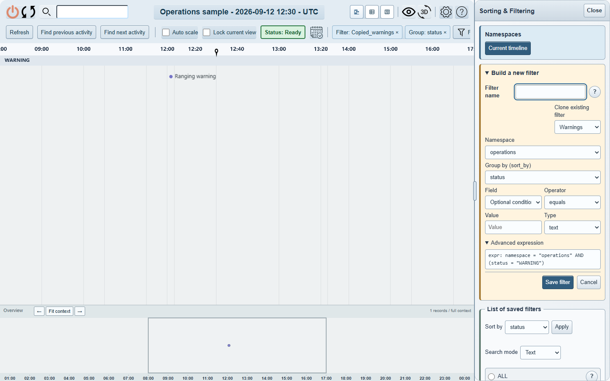

# Compact Sorting & Filtering

Version 2.8.0 groups Sorting & Filtering into three contrasting sections:
Namespaces stays expanded, Build a new filter starts collapsed, and List of
saved filters uses compact rows. Namespace navigation lives here instead of
above the timeline and reuses previously opened timelines.

Expanding the builder exposes Filter name, a top-right Clone existing filter
selector, Namespace, Group by (`sort_by`), condition controls and Advanced
expression. Namespace choices come from configured sources and loaded records;
grouping fields include event/session attributes such as title, status and type.
One Save filter/Cancel row sits at the bottom. Cloning preserves the expression
and grouping without applying them; saving requires a distinct name. Legacy
expressions can be cloned and edited directly in Advanced expression.

Selecting a saved filter applies it immediately. Each row ends with a keyboard
accessible `?` for expression help. Edit unlocks the copyable expression;
Save validates and persists it, while Cancel or Escape restores the saved value.
Expression previews grow and shrink with their content. Narrow panels stack
the controls and textarea, and high contrast strengthens borders and focus.

The screenshot uses synthetic filter names and expressions in the public demo.
It was captured in Chromium at a 1440 by 900 viewport with the panel expanded.

The browser regression in `tests/browser/filter-panel.spec.mjs` checks desktop
and narrow layouts, contextual help without extra data requests, validation,
cancellation, persistence, deletion, growing and shrinking long expressions,
and focus in high contrast. HBDS browser tests cover namespace selection and
reuse of previously visited timelines.
